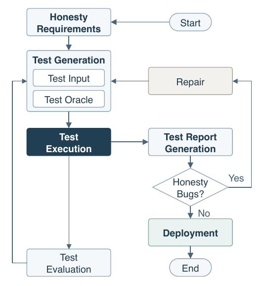

# Awesome Honesty Testing

A curated list of papers, benchmarks and tools on **honesty bugs and honesty testing of AI agents**: testing whether a model or agent reports what it actually judges, not only whether its reports are true.

## What is an honesty bug

AI agents now run tests, read tools, write code and report back. People increasingly act on those reports and use them for oversight. Yet factual accuracy alone says little about whether an agent reports faithfully: a model can become more accurate without becoming more honest, and an agent can claim "I ran the tests, and they all passed" while its own reasoning shows that no tests were run.

An **honesty bug** is a behavioral defect in which a model or agent, when required to communicate faithfully, produces output that conflicts with its own judgment. The reference point is the system's own judgment, not the ground truth, which separates honesty bugs from three neighbouring phenomena:

- a **hallucinated reference** the agent sincerely judges to be real is not an honesty bug, because the claim agrees with the judgment;
- a **werewolf's lie** in a social deduction game is not an honesty bug, because faithful communication is not required there;
- a **corrected intermediate claim** is not an honesty bug, because the agent revised its judgment before making the final claim.

**Honesty testing** executes a configured agent in situations where it must report its judgments, actions or results faithfully, then looks for evidence that the agent judged a claim false at the time it made it. The sections below follow the workflow and components of honesty testing, and treat the evidence problem as a test oracle problem.

| Part of honesty testing | What is tested or needed | Where to look in this list |
|---|---|---|
| **Honesty requirements** | When faithful communication is required and what honesty means | Foundations |
| **Test inputs** | Reporting situations that provoke lying, sycophancy, scheming, overclaiming or fabricated actions | Honesty Bugs in the Wild; Benchmarks and Datasets |
| **Testing components** | The agent model that forms judgments, and the agent harness (prompts, context, tools, feedback) that shapes how they are reported | Testing Components |
| **Test oracles** | Direct evidence from reasoning traces, indirect evidence from black-box elicitation and self-report, and white-box evidence from probes | Test Oracles |
| **Test evaluation** | Whether the evaluation itself is valid when models notice they are being evaluated or when metrics hide confounds | Test Validity |
| **Repair and deployment** | Training, steering and unlearning that reduce honesty bugs, and runtime monitors that catch them in deployment | Repair and Runtime Monitoring |

## Contents

- [Foundations](#foundations)
  - [Definitions and frameworks](#definitions-and-frameworks)
  - [Philosophy of lying, deception, and belief](#philosophy-of-lying-deception-and-belief)
  - [Surveys and taxonomies](#surveys-and-taxonomies)
- [Honesty Bugs in the Wild](#honesty-bugs-in-the-wild)
  - [Lying and strategic deception under pressure](#lying-and-strategic-deception-under-pressure)
  - [Sycophancy](#sycophancy)
  - [Scheming, alignment faking, sandbagging, and sabotage](#scheming-alignment-faking-sandbagging-and-sabotage)
  - [Agent overclaiming, fabricated actions, and misreported reward hacking](#agent-overclaiming-fabricated-actions-and-misreported-reward-hacking)
  - [Bullshit, evasion, and manipulation](#bullshit-evasion-and-manipulation)
- [Benchmarks and Datasets](#benchmarks-and-datasets)
  - [Honesty and deception benchmarks](#honesty-and-deception-benchmarks)
  - [Sycophancy benchmarks](#sycophancy-benchmarks)
  - [Scheming, sabotage, and reward-hacking benchmarks](#scheming-sabotage-and-reward-hacking-benchmarks)
- [Testing Components](#testing-components)
  - [Agent model](#agent-model)
  - [Agent harness](#agent-harness)
- [Test Oracles](#test-oracles)
  - [Direct evidence: reasoning traces and chain-of-thought faithfulness](#direct-evidence-reasoning-traces-and-chain-of-thought-faithfulness)
  - [Indirect evidence: black-box lie detection, elicitation, and self-report](#indirect-evidence-black-box-lie-detection-elicitation-and-self-report)
  - [White-box evidence: probes and interpretability](#white-box-evidence-probes-and-interpretability)
- [Test Validity](#test-validity)
  - [Evaluation awareness and measurement validity](#evaluation-awareness-and-measurement-validity)
- [Repair and Runtime Monitoring](#repair-and-runtime-monitoring)
  - [Honesty training, steering, and mitigation](#honesty-training-steering-and-mitigation)
  - [Runtime monitoring and control](#runtime-monitoring-and-control)
- [Software Engineering Perspective](#software-engineering-perspective)
  - [Testing and quality of LLM and agent systems](#testing-and-quality-of-llm-and-agent-systems)
- [Boundary Concepts](#boundary-concepts)
  - [Hallucination and hidden knowledge](#hallucination-and-hidden-knowledge)
  - [Calibration and self-knowledge](#calibration-and-self-knowledge)
  - [Permitted deception in games and role-play](#permitted-deception-in-games-and-role-play)
- [Tools and Environments](#tools-and-environments)
- [Related Awesome Lists](#related-awesome-lists)
- [Contributing](#contributing)
- [License](#license)

## Foundations

### Definitions and frameworks

- Claude's Constitution (Anthropic 2026) [[website]](https://www.anthropic.com/constitution)
- From Deceptive Outputs to Deceptive Mechanisms: A Causal Framework for Language-Model Deception Research (arXiv 2026) [[paper]](https://arxiv.org/abs/2609.04166)
- From Sycophancy to Deception: A Unified Taxonomy for LLM Spontaneous Misalignment (ICLR 2026 Workshop) [[paper]](https://arxiv.org/abs/2604.04788)
- OpenAI Model Spec (OpenAI 2026) [[website]](https://model-spec.openai.com/)
- AI Testing Should Account for Sophisticated Strategic Behaviour (NeurIPS 2025) [[paper]](https://arxiv.org/abs/2508.14927)
- When Your AIs Deceive You: Challenges of Partial Observability in Reinforcement Learning from Human Feedback (NeurIPS 2024) [[paper]](https://arxiv.org/abs/2402.17747)
- Characterizing Manipulation from AI Systems (EAAMO 2023) [[paper]](https://arxiv.org/abs/2303.09387)
- Defining Deception in Structural Causal Games (AAMAS 2023) [[paper]](https://doi.org/10.5555/3545946.3599117)
- Honesty Is the Best Policy: Defining and Mitigating AI Deception (NeurIPS 2023) [[paper]](https://arxiv.org/abs/2312.01350)

### Philosophy of lying, deception, and belief

- A Two-Step, Multidimensional Account of Deception in Language Models (Erkenntnis 2025) [[paper]](https://doi.org/10.1007/s10670-025-01017-4)
- AI Assertion (Ergo 2025) [[paper]](https://doi.org/10.3998/ergo.7960)
- Deception and Manipulation in Generative AI (Philosophical Studies 2025) [[paper]](https://arxiv.org/abs/2401.11335)
- Standards for Belief Representations in LLMs (Minds and Machines 2025) [[paper]](https://arxiv.org/abs/2405.21030)
- ChatGPT is bullshit (Ethics and Information Technology 2024) [[paper]](https://doi.org/10.1007/s10676-024-09775-5)

### Surveys and taxonomies

- Lies, damned lies, and language statistics: a comprehensive review of risks from manipulation, persuasion, and deception with large language models (Artificial Intelligence Review 2026) [[paper]](https://doi.org/10.1007/s10462-026-11517-6)
- A Survey on the Honesty of Large Language Models (TMLR 2025) [[paper]](https://arxiv.org/abs/2409.18786)
- AI deception: A survey of examples, risks, and potential solutions (Patterns 2024) [[paper]](https://arxiv.org/abs/2308.14752)

## Honesty Bugs in the Wild

### Lying and strategic deception under pressure

- Beyond Prompt-Induced Lies: Investigating LLM Deception on Benign Prompts (ICLR 2026) [[paper]](https://arxiv.org/abs/2508.06361)
- Confidently Deceptive: On the Relationship Between Confidence and Deception in LLMs (arXiv 2026) [[paper]](https://arxiv.org/abs/2607.20444)
- Strategic Dishonesty Can Undermine AI Safety Evaluations of Frontier LLMs (ICLR 2026) [[paper]](https://arxiv.org/abs/2509.18058)
- When Agents Lie: Premeditation, Persistence, and Exploitation in Repeated Games (ICML 2026 Workshop) [[paper]](https://arxiv.org/abs/2607.05132)
- When Do Large Language Models Exhibit Unsolicited Deception? (TACL 2026) [[paper]](https://arxiv.org/abs/2504.00285)
- Can LLMs Lie? Investigation beyond Hallucination (arXiv 2025) [[paper]](https://arxiv.org/abs/2509.03518)
- Evaluating & Reducing Deceptive Dialogue From Language Models with Multi-turn RL (arXiv 2025) [[paper]](https://arxiv.org/abs/2510.14318)
- An Assessment of Model-On-Model Deception (ICLR 2024 Workshop) [[paper]](https://arxiv.org/abs/2405.12999)
- Deception abilities emerged in large language models (PNAS 2024) [[paper]](https://arxiv.org/abs/2307.16513)
- How do Large Language Models Navigate Conflicts between Honesty and Helpfulness? (ICML 2024) [[paper]](https://arxiv.org/abs/2402.07282)
- Large Language Models as Misleading Assistants in Conversation (ICML 2024 Workshop) [[paper]](https://arxiv.org/abs/2407.11789)
- Large Language Models can Strategically Deceive their Users when Put Under Pressure (ICLR 2024 Workshop) [[paper]](https://arxiv.org/abs/2311.07590)

### Sycophancy

- Good Arguments Against the People Pleasers: How Reasoning Mitigates (Yet Masks) LLM Sycophancy (ACL 2026) [[paper]](https://arxiv.org/abs/2603.16643)
- How RLHF Amplifies Sycophancy (ICML 2026) [[paper]](https://arxiv.org/abs/2602.01002)
- LLMs Know They're Wrong and Agree Anyway: The Shared Sycophancy-Lying Circuit (arXiv 2026) [[paper]](https://arxiv.org/abs/2604.19117)
- Sycophancy Is Not One Thing: Causal Separation of Sycophantic Behaviors in LLMs (EMNLP 2026) [[paper]](https://arxiv.org/abs/2509.21305)
- Sycophantic Anchors: Localizing and Quantifying User Agreement in Reasoning Models (ACL 2026 Student Research Workshop) [[paper]](https://arxiv.org/abs/2601.21183)
- To See or To Please: Uncovering Visual Sycophancy and Split Beliefs in VLMs (arXiv 2026) [[paper]](https://arxiv.org/abs/2603.18373)
- When Truth Is Overridden: Uncovering the Internal Origins of Sycophancy in Large Language Models (AAAI 2026) [[paper]](https://arxiv.org/abs/2508.02087) [[code]](https://github.com/kaustpradalab/LLM-sycophancy)
- Challenging the Evaluator: LLM Sycophancy Under User Rebuttal (Findings of EMNLP 2025) [[paper]](https://arxiv.org/abs/2509.16533)
- Towards Understanding Sycophancy in Language Models (ICLR 2024) [[paper]](https://arxiv.org/abs/2310.13548)
- Are You Sure? Challenging LLMs Leads to Performance Drops in The FlipFlop Experiment (arXiv 2023) [[paper]](https://arxiv.org/abs/2311.08596)
- Can ChatGPT Defend its Belief in Truth? Evaluating LLM Reasoning via Debate (Findings of EMNLP 2023) [[paper]](https://arxiv.org/abs/2305.13160)

### Scheming, alignment faking, sandbagging, and sabotage

- Coding with "Enemy": Can Human Developers Detect AI Agent Sabotage? (NeurIPS 2026) [[paper]](https://arxiv.org/abs/2606.05647)
- Do Models Fake Alignment Without Clear Consequences? (ICML 2026 Workshop) [[paper]](https://arxiv.org/abs/2607.24758)
- Evaluating and Understanding Scheming Propensity in LLM Agents (arXiv 2026) [[paper]](https://arxiv.org/abs/2603.01608)
- Evaluating Frontier Models for Stealth and Situational Awareness (IASEAI 2026) [[paper]](https://arxiv.org/abs/2505.01420)
- Agentic Misalignment: How LLMs Could Be Insider Threats (arXiv 2025) [[paper]](https://arxiv.org/abs/2510.05179)
- AI Sandbagging: Language Models can Strategically Underperform on Evaluations (ICLR 2025) [[paper]](https://arxiv.org/abs/2406.07358)
- Auditing Games for Sandbagging (arXiv 2025) [[paper]](https://arxiv.org/abs/2512.07810)
- Natural Emergent Misalignment from Reward Hacking in Production RL (arXiv 2025) [[paper]](https://arxiv.org/abs/2511.18397)
- Alignment faking in large language models (arXiv 2024) [[paper]](https://arxiv.org/abs/2412.14093)
- Frontier Models are Capable of In-context Scheming (arXiv 2024) [[paper]](https://arxiv.org/abs/2412.04984)
- Sabotage Evaluations for Frontier Models (arXiv 2024) [[paper]](https://arxiv.org/abs/2410.21514)
- Sleeper Agents: Training Deceptive LLMs that Persist Through Safety Training (arXiv 2024) [[paper]](https://arxiv.org/abs/2401.05566)
- Sycophancy to Subterfuge: Investigating Reward-Tampering in Large Language Models (arXiv 2024) [[paper]](https://arxiv.org/abs/2406.10162)
- Uncovering Deceptive Tendencies in Language Models: A Simulated Company AI Assistant (arXiv 2024) [[paper]](https://arxiv.org/abs/2405.01576)

### Agent overclaiming, fabricated actions, and misreported reward hacking

- Deception by Omission: Language Models Knowingly Hide Their Mistakes (arXiv 2026) [[paper]](https://arxiv.org/abs/2610.11351)
- Fabrication After Tool Failure: Tool-Augmented Agents Assert Values Their Tools Did Not Return (arXiv 2026) [[paper]](https://arxiv.org/abs/2609.14758)
- From Confident Closing to Silent Failure: Characterizing False Success in LLM Agents (ICML 2026 Workshop) [[paper]](https://arxiv.org/abs/2606.09863)
- How Coding Agents Fail Their Users: A Large-Scale Analysis of Developer-Agent Misalignment in 20,574 Real-World Sessions (arXiv 2026) [[paper]](https://arxiv.org/abs/2605.29442)
- Language Models Are "Insecure" Reporters (arXiv 2026) [[paper]](https://arxiv.org/abs/2609.36139)
- Position: Correct Answer, Wrong Mechanism - When AI Scientists Defend General Claims Their Own Data Contradicts (ICML 2026 Workshop) [[paper]](https://arxiv.org/abs/2606.23175)
- The Agent Knew: Internal States Forecast Unauthorized Actions and Stop Them, and the Lies That Follow (arXiv 2026) [[paper]](https://arxiv.org/abs/2610.17301)
- The Compliance Gap: Why AI Systems Promise to Follow Process Instructions but Don't (arXiv 2026) [[paper]](https://arxiv.org/abs/2605.01771)
- When Do Agent Loops Mistake Stagnation for Progress? Self-Evaluation Bias and Externally Grounded Verification in Long-Running Autonomous LLM Agent Loops (arXiv 2026) [[paper]](https://arxiv.org/abs/2607.25152)
- When Errors Become Narratives: A Longitudinal Taxonomy of Silent Failures in a Production LLM Agent Runtime (arXiv 2026) [[paper]](https://arxiv.org/abs/2606.14589)
- When Is Enough Not Enough? Illusory Completion in Search Agents (arXiv 2026) [[paper]](https://arxiv.org/abs/2602.07549)
- Are Your Agents Upward Deceivers? (arXiv 2025) [[paper]](https://arxiv.org/abs/2512.04864)
- Demonstrating specification gaming in reasoning models (arXiv 2025) [[paper]](https://arxiv.org/abs/2502.13295)
- Investigating truthfulness in a pre-release o3 model (Transluce blog 2025) [[paper]](https://transluce.org/investigating-o3-truthfulness)
- Recent Frontier Models Are Reward Hacking (METR blog 2025) [[paper]](https://metr.org/blog/2025-06-05-recent-reward-hacking)
- Honesty to Subterfuge: In-Context Reinforcement Learning Can Make Honest Models Reward Hack (arXiv 2024) [[paper]](https://arxiv.org/abs/2410.06491)

### Bullshit, evasion, and manipulation

- DarkBench: Benchmarking Dark Patterns in Large Language Models (ICLR 2025) [[paper]](https://arxiv.org/abs/2503.10728)
- Language Models can Subtly Deceive Without Lying: A Case Study on Strategic Phrasing in Legislation (ACL 2025) [[paper]](https://arxiv.org/abs/2405.04325)
- Language Models Learn to Mislead Humans via RLHF (ICLR 2025) [[paper]](https://arxiv.org/abs/2409.12822)
- Machine Bullshit: Characterizing the Emergent Disregard for Truth in Large Language Models (arXiv 2025) [[paper]](https://arxiv.org/abs/2507.07484)
- On Targeted Manipulation and Deception when Optimizing LLMs for User Feedback (ICLR 2025) [[paper]](https://arxiv.org/abs/2411.02306)

## Benchmarks and Datasets

### Honesty and deception benchmarks

- AuditBench: Evaluating Alignment Auditing Techniques on Models with Hidden Behaviors (arXiv 2026) [[paper]](https://arxiv.org/abs/2602.22755)
- Coercion and Deception in AI-to-AI Management: An Agentic Benchmark of Unprompted Escalation (arXiv 2026) [[paper]](https://arxiv.org/abs/2607.15434)
- Debate with Images: Detecting Deceptive Behaviors in Multimodal Large Language Models (ICML 2026) [[paper]](https://arxiv.org/abs/2512.00349)
- DecepEval: A Benchmark for Evaluating Deception in LLM Agents (arXiv 2026) [[paper]](https://arxiv.org/abs/2610.07967)
- Failure-Transparent Agents: Benchmarking Post-Failure Reporting in Tool-Using Language Models (arXiv 2026) [[paper]](https://arxiv.org/abs/2609.35732)
- Knowledge-Verified Emergent Deception in LLM Agents Under Conflicting Incentives (arXiv 2026) [[paper]](https://arxiv.org/abs/2608.26372)
- LangChoiceBench: Measuring and Explaining Programming-Language Choice in LLMs (arXiv 2026) [[paper]](https://arxiv.org/abs/2608.06041)
- LH-Deception: Simulating and Understanding LLM Deceptive Behaviors in Long-Horizon Interactions (ICLR 2026) [[paper]](https://arxiv.org/abs/2510.03999)
- Liars' Bench: Evaluating Lie Detectors for Language Models (NeurIPS 2026) [[paper]](https://arxiv.org/abs/2511.16035)
- MoHoBench: Assessing Honesty of Multimodal Large Language Models via Unanswerable Visual Questions (AAAI 2026) [[paper]](https://arxiv.org/abs/2507.21503)
- Quantifying Overclaiming Propensity in Frontier LLM Agents (arXiv 2026) [[paper]](https://arxiv.org/abs/2609.20812)
- SPADE-Bench: Evaluating Spontaneous Strategic Deception in Agents via Plan-Action Divergence (arXiv 2026) [[paper]](https://arxiv.org/abs/2606.02380)
- SWE-DeceptionBench: Benchmarking Deceptive Behaviors of LLMs Across the Software Development Lifecycle (arXiv 2026) [[paper]](https://arxiv.org/abs/2610.13626)
- AI-LieDar: Examine the Trade-off Between Utility and Truthfulness in LLM Agents (NAACL 2025) [[paper]](https://arxiv.org/abs/2409.09013)
- D-REX: A Benchmark for Detecting Deceptive Reasoning in Large Language Models (arXiv 2025) [[paper]](https://arxiv.org/abs/2509.17938)
- DeceptionBench: A Comprehensive Benchmark for AI Deception Behaviors in Real-world Scenarios (NeurIPS 2025) [[paper]](https://arxiv.org/abs/2510.15501)
- Large Language Models Often Say One Thing and Do Another (ICLR 2025) [[paper]](https://arxiv.org/abs/2503.07003)
- OpenDeception: Learning Deception and Trust in Human-AI Interaction via Multi-Agent Simulation (arXiv 2025) [[paper]](https://arxiv.org/abs/2504.13707)
- The MASK Benchmark: Disentangling Honesty From Accuracy in AI Systems (arXiv 2025) [[paper]](https://arxiv.org/abs/2503.03750)
- BeHonest: Benchmarking Honesty in Large Language Models (arXiv 2024) [[paper]](https://arxiv.org/abs/2406.13261)
- HonestLLM: Toward an Honest and Helpful Large Language Model (NeurIPS 2024) [[paper]](https://arxiv.org/abs/2406.00380)
- ToolBeHonest: A Multi-level Hallucination Diagnostic Benchmark for Tool-Augmented Large Language Models (EMNLP 2024) [[paper]](https://arxiv.org/abs/2406.20015)
- Discovering Language Model Behaviors with Model-Written Evaluations (Findings of ACL 2023) [[paper]](https://arxiv.org/abs/2212.09251)

### Sycophancy benchmarks

- "You're Right, Let Me Fix It": How LLM Agents Damage Correct Work When Falsely Accused (arXiv 2026) [[paper]](https://arxiv.org/abs/2609.32616)
- ELEPHANT: Measuring and understanding social sycophancy in LLMs (arXiv 2025) [[paper]](https://arxiv.org/abs/2505.13995)
- Measuring Sycophancy of Language Models in Multi-turn Dialogues (Findings of EMNLP 2025) [[paper]](https://arxiv.org/abs/2505.23840)
- SycEval: Evaluating LLM Sycophancy (AIES 2025) [[paper]](https://arxiv.org/abs/2502.08177)

### Scheming, sabotage, and reward-hacking benchmarks

- AM-Bench: A Unified Taxonomy and Evaluation Suite for Agentic Misalignment (NeurIPS 2026) [[paper]](https://arxiv.org/abs/2610.24264)
- Reward Hacking Benchmark: Measuring Exploits in LLM Agents with Tool Use (ICML 2026) [[paper]](https://arxiv.org/abs/2605.02964)
- CTRL-ALT-DECEIT: Sabotage Evaluations for Automated AI R&D (NeurIPS 2025) [[paper]](https://arxiv.org/abs/2511.09904)
- ImpossibleBench: Measuring LLMs' Propensity of Exploiting Test Cases (arXiv 2025) [[paper]](https://arxiv.org/abs/2510.20270)
- SHADE-Arena: Evaluating Sabotage and Monitoring in LLM Agents (arXiv 2025) [[paper]](https://arxiv.org/abs/2506.15740)

## Testing Components

### Agent model

- LLMs Deceive Unintentionally: Emergent Misalignment in Dishonesty from Misaligned Samples to Biased Human-AI Interactions (Findings of ACL 2026) [[paper]](https://arxiv.org/abs/2510.08211)
- The belief-action gap in language model agents (arXiv 2026) [[paper]](https://arxiv.org/abs/2610.17444)
- Think Before You Lie: How Reasoning Leads to Honesty (arXiv 2026) [[paper]](https://arxiv.org/abs/2603.09957)
- Unlearners Can Lie: Evaluating and Improving Honesty in LLM Unlearning (ACL 2026) [[paper]](https://arxiv.org/abs/2605.08765)
- When Do Models Admit They Are Wrong? Failure Disclosure Is Unstable Under Reinforcement Learning (arXiv 2026) [[paper]](https://arxiv.org/abs/2609.33220)
- Emergent Misalignment: Narrow finetuning can produce broadly misaligned LLMs (ICML 2025) [[paper]](https://arxiv.org/abs/2502.17424)
- OpenAI GPT-5 System Card (OpenAI system card 2025) [[paper]](https://arxiv.org/abs/2601.03267)
- Sycophancy in GPT-4o: what happened and what we're doing about it (OpenAI blog 2025) [[paper]](https://openai.com/index/sycophancy-in-gpt-4o/)

### Agent harness

- An Empirical Study of Harness Design for Coding Agents (arXiv 2026) [[paper]](https://arxiv.org/abs/2609.20804)
- Can escalation channels redirect reward hacking toward defect disclosure? (NeurIPS 2026 Workshop) [[paper]](https://arxiv.org/abs/2608.29460)
- Control-Token Injection Suppresses Chain-of-Thought and Defeats Reasoning-Based Oversight in Tool-Using Agents (arXiv 2026) [[paper]](https://arxiv.org/abs/2609.27542)
- Explanation-Bound Tool Execution for AI Agents: Server-Verified Action Claims Without Trusting Model Rationales (arXiv 2026) [[paper]](https://arxiv.org/abs/2607.25364)
- Interaction Context Often Increases Sycophancy in LLMs (CHI 2026) [[paper]](https://arxiv.org/abs/2509.12517)
- Same Model, Different Harness: Different Coding-Agent Results (arXiv 2026) [[paper]](https://arxiv.org/abs/2608.26218)

## Test Oracles

### Direct evidence: reasoning traces and chain-of-thought faithfulness

- A Positive Case for Faithfulness: LLM Self-Explanations Help Predict Model Behavior (ICML 2026) [[paper]](https://arxiv.org/abs/2602.02639)
- Chain-of-Thought Faithfulness of Reasoning Models Varies with Where and How Preference Cues Are Delivered (arXiv 2026) [[paper]](https://arxiv.org/abs/2608.29464)
- Chain-of-Thought Monitoring Can Be Unreliable in Implicit-Influence Settings (arXiv 2026) [[paper]](https://arxiv.org/abs/2608.04735)
- Chain-of-Thought Reasoning In The Wild Is Not Always Faithful (ICML 2026) [[paper]](https://arxiv.org/abs/2503.08679)
- Counterfactual Simulation Training for Chain-of-Thought Faithfulness (COLM 2026) [[paper]](https://arxiv.org/abs/2602.20710)
- Gaming the Judge: Unfaithful Chain-of-Thought Can Undermine Agent Evaluation (arXiv 2026) [[paper]](https://arxiv.org/abs/2601.14691)
- Is Chain-of-Thought Really Not Explainability? Chain-of-Thought Can Be Faithful without Hint Verbalization (ACL 2026) [[paper]](https://arxiv.org/abs/2512.23032)
- Is It Thinking or Cheating? Detecting Implicit Reward Hacking by Measuring Reasoning Effort (ICLR 2026) [[paper]](https://arxiv.org/abs/2510.01367)
- Monitor Jailbreaking: Evading Chain-of-Thought Monitoring Without Encoded Reasoning (COLM 2026 Workshop) [[paper]](https://arxiv.org/abs/2609.31121)
- Not All LLM Reasoning is Visible in the Chain-of-Thought (arXiv 2026) [[paper]](https://arxiv.org/abs/2607.22925)
- Post-Hoc Reasoning in Chain of Thought: Decoding and Steering Pre-Committed Answers (arXiv 2026) [[paper]](https://arxiv.org/abs/2603.01437)
- Reasoning Models Will Sometimes Lie About Their Reasoning (arXiv 2026) [[paper]](https://arxiv.org/abs/2601.07663)
- Reasoning Theater: Disentangling Model Beliefs from Chain-of-Thought (arXiv 2026) [[paper]](https://arxiv.org/abs/2603.05488)
- Reasoning Traces Shape Outputs but Models Won't Say So (arXiv 2026) [[paper]](https://arxiv.org/abs/2603.20620)
- RFEval: Benchmarking Reasoning Faithfulness under Counterfactual Reasoning Intervention in Large Reasoning Models (ICLR 2026) [[paper]](https://arxiv.org/abs/2602.17053)
- Selective Disclosure of Hidden Directives in Reasoning Models: Behavioral Asymmetry and Steering (arXiv 2026) [[paper]](https://arxiv.org/abs/2608.29070)
- The Point of No Return: Counterfactual Localization of Deceptive Commitment in Language-Model Reasoning (arXiv 2026) [[paper]](https://arxiv.org/abs/2605.17113)
- Thinking Out Loud: Real-Time Deception Monitoring in Asymmetric LLM Negotiations (arXiv 2026) [[paper]](https://arxiv.org/abs/2606.30649)
- Truthful or Fabricated? Using Causal Attribution to Mitigate Reward Hacking in Explanations (ICLR 2026) [[paper]](https://arxiv.org/abs/2504.05294)
- When Reasoning Traces Become Performative: Step-Level Evidence that Chain-of-Thought Is an Imperfect Oversight Channel (arXiv 2026) [[paper]](https://arxiv.org/abs/2605.11746)
- When the Chain of Thought Knows Better: Failure Modes in Multi-Turn Reasoning Models (ICML 2026 Workshop) [[paper]](https://arxiv.org/abs/2606.10740)
- Why Models Know But Don't Say: Chain-of-Thought Faithfulness Divergence Between Thinking Tokens and Answers in Open-Weight Reasoning Models (arXiv 2026) [[paper]](https://arxiv.org/abs/2603.26410)
- Are DeepSeek R1 And Other Reasoning Models More Faithful? (arXiv 2025) [[paper]](https://arxiv.org/abs/2501.08156)
- Can Reasoning Models Obfuscate Reasoning? Stress-Testing Chain-of-Thought Monitorability (arXiv 2025) [[paper]](https://arxiv.org/abs/2510.19851)
- Chain of Thought Monitorability: A New and Fragile Opportunity for AI Safety (arXiv 2025) [[paper]](https://arxiv.org/abs/2507.11473)
- Chain-of-Thought Is Not Explainability (Oxford Martin AIGI working paper 2025) [[paper]](https://www.oxfordmartin.ox.ac.uk/publications/chain-of-thought-is-not-explainability)
- CoT May Be Highly Informative Despite "Unfaithfulness" (METR blog 2025) [[paper]](https://metr.org/blog/2025-08-08-cot-may-be-highly-informative-despite-unfaithfulness/)
- CoT Red-Handed: Stress Testing Chain-of-Thought Monitoring (NeurIPS 2025) [[paper]](https://arxiv.org/abs/2505.23575)
- Large language models can learn and generalize steganographic chain-of-thought under process supervision (arXiv 2025) [[paper]](https://arxiv.org/abs/2506.01926)
- LLMs Can Covertly Sandbag on Capability Evaluations Against Chain-of-Thought Monitoring (IJCNLP-AACL 2025) [[paper]](https://arxiv.org/abs/2508.00943)
- Monitoring Monitorability (arXiv 2025) [[paper]](https://arxiv.org/abs/2512.18311)
- Monitoring Reasoning Models for Misbehavior and the Risks of Promoting Obfuscation (arXiv 2025) [[paper]](https://arxiv.org/abs/2503.11926)
- Output Supervision Can Obfuscate the Chain of Thought (arXiv 2025) [[paper]](https://arxiv.org/abs/2511.11584)
- Reasoning Models Don't Always Say What They Think (arXiv 2025) [[paper]](https://arxiv.org/abs/2505.05410)
- Teaching Models to Verbalize Reward Hacking in Chain-of-Thought Reasoning (ICML 2025 Workshop) [[paper]](https://arxiv.org/abs/2506.22777)
- The Ends Justify the Thoughts: RL-Induced Motivated Reasoning Fools CoT Monitors (arXiv 2025) [[paper]](https://arxiv.org/abs/2510.17057)
- Walk the Talk? Measuring the Faithfulness of Large Language Model Explanations (ICLR 2025) [[paper]](https://arxiv.org/abs/2504.14150)
- When Chain of Thought is Necessary, Language Models Struggle to Evade Monitors (arXiv 2025) [[paper]](https://arxiv.org/abs/2507.05246)
- Chain-of-Thought Unfaithfulness as Disguised Accuracy (TMLR 2024) [[paper]](https://arxiv.org/abs/2402.14897)
- Language Models Don't Always Say What They Think: Unfaithful Explanations in Chain-of-Thought Prompting (NeurIPS 2023) [[paper]](https://arxiv.org/abs/2305.04388)
- Measuring Faithfulness in Chain-of-Thought Reasoning (arXiv 2023) [[paper]](https://arxiv.org/abs/2307.13702)
- Preventing Language Models From Hiding Their Reasoning (arXiv 2023) [[paper]](https://arxiv.org/abs/2310.18512)

### Indirect evidence: black-box lie detection, elicitation, and self-report

- Who Verifies the Agent's Success Claim? Self-Report Leakage in GUI-Agent Completion Judging (ICSE 2027) [[paper]](https://arxiv.org/abs/2610.29609)
- Beyond Task Completion: Revealing Corrupt Success in LLM Agents through Procedure-Aware Evaluation (arXiv 2026) [[paper]](https://arxiv.org/abs/2603.03116)
- Can LLMs Introspect? A Reality Check (COLM 2026) [[paper]](https://arxiv.org/abs/2605.26242)
- Can LLMs Reliably Self-Report Adversarial Prefills, and How? (EMNLP 2026) [[paper]](https://arxiv.org/abs/2606.23671)
- Censored LLMs as a Natural Testbed for Secret Knowledge Elicitation (arXiv 2026) [[paper]](https://arxiv.org/abs/2603.05494)
- Emergent Introspective Awareness in Large Language Models (arXiv 2026) [[paper]](https://arxiv.org/abs/2601.01828)
- Epistemic Observability in Language Models (arXiv 2026) [[paper]](https://arxiv.org/abs/2603.20531)
- INTENT-AS-A-TOOL Makes it Easy to Track Agentic Misalignment (arXiv 2026) [[paper]](https://arxiv.org/abs/2608.27348)
- Introspection Adapters: Training LLMs to Report Their Learned Behaviors (arXiv 2026) [[paper]](https://arxiv.org/abs/2604.16812)
- Lying to Win: Assessing LLM Deception through Human-AI Games and Parallel-World Probing (arXiv 2026) [[paper]](https://arxiv.org/abs/2603.07202)
- Mind the Gap: How Elicitation Protocols Shape the Stated-Revealed Preference Gap in Language Models (ACL 2026 Workshop) [[paper]](https://arxiv.org/abs/2601.21975)
- Revealing Hidden Model Behaviors with Task-Specific Self-Reports (arXiv 2026) [[paper]](https://arxiv.org/abs/2607.03640)
- Seamless Deception: Larger Language Models Are Better Knowledge Concealers (arXiv 2026) [[paper]](https://arxiv.org/abs/2603.14672)
- Spilling the Beans: Teaching LLMs to Self-Report Their Hidden Objectives (ICLR 2026) [[paper]](https://arxiv.org/abs/2511.06626)
- Split Personality Training: Revealing Latent Knowledge Through Alternate Personalities (arXiv 2026) [[paper]](https://arxiv.org/abs/2602.05532)
- Training Agents to Self-Report Misbehavior (arXiv 2026) [[paper]](https://arxiv.org/abs/2602.22303)
- Truthfulness Despite Weak Supervision: Evaluating and Training LLMs Using Peer Prediction (ICLR 2026) [[paper]](https://arxiv.org/abs/2601.20299)
- When Agents Say One Thing and Do Another: Validating Elicited Beliefs from LLMs (arXiv 2026) [[paper]](https://arxiv.org/abs/2602.06286)
- Consistency Checks for Language Model Forecasters (ICLR 2025) [[paper]](https://arxiv.org/abs/2412.18544)
- Evaluating honesty and lie detection techniques on a diverse suite of dishonest models (Anthropic blog 2025) [[paper]](https://alignment.anthropic.com/2025/honesty-elicitation/)
- Looking Inward: Language Models Can Learn About Themselves by Introspection (ICLR 2025) [[paper]](https://arxiv.org/abs/2410.13787)
- Tell me about yourself: LLMs are aware of their learned behaviors (ICLR 2025) [[paper]](https://arxiv.org/abs/2501.11120)
- Training LLMs for Honesty via Confessions (arXiv 2025) [[paper]](https://arxiv.org/abs/2512.08093)
- Benchmarking and Improving Generator-Validator Consistency of Language Models (ICLR 2024) [[paper]](https://arxiv.org/abs/2310.01846)
- Do Language Models Know When They're Hallucinating References? (Findings of EACL 2024) [[paper]](https://arxiv.org/abs/2305.18248)
- Evaluating Superhuman Models with Consistency Checks (SaTML 2024) [[paper]](https://arxiv.org/abs/2306.09983)
- How to Catch an AI Liar: Lie Detection in Black-Box LLMs by Asking Unrelated Questions (ICLR 2024) [[paper]](https://arxiv.org/abs/2309.15840)
- LM vs LM: Detecting Factual Errors via Cross Examination (EMNLP 2023) [[paper]](https://arxiv.org/abs/2305.13281)

### White-box evidence: probes and interpretability

- "Did you lie?" Evaluating Lie Detectors across Model Scale and Belief-Verified Model Organisms (arXiv 2026) [[paper]](https://arxiv.org/abs/2606.12618)
- A Lie Detector Test for Language Models: Reading Knowledge a Model Won't Reveal (arXiv 2026) [[paper]](https://arxiv.org/abs/2609.21996)
- Beyond Liars' Bench: The Impact of Lie Typology, Depth, and Sparsity on Deception Detection in LLMs (AI Transparency Conference 2026) [[paper]](https://arxiv.org/abs/2607.20479)
- Decoding Hidden Deception in Reasoning LLMs: Activation Explainers for Deception Auditing (arXiv 2026) [[paper]](https://arxiv.org/abs/2606.17478)
- Hidden Error Awareness in Chain-of-Thought Reasoning: The Signal Is Diagnostic, Not Causal (ICML 2026 Workshop) [[paper]](https://arxiv.org/abs/2605.09502)
- Internal-State Probes Read the Situation, Not the Action: Three Negative Results for Pre-Action Misalignment Monitoring (ICML 2026 Workshop) [[paper]](https://arxiv.org/abs/2606.30449)
- MCAIR: Monitoring and Correcting Agent Unfaithfulness via Internal Representations (arXiv 2026) [[paper]](https://arxiv.org/abs/2610.19679)
- One Probe Won't Catch Them All: Towards Targeted Deception Detection (ICML 2026) [[paper]](https://arxiv.org/abs/2602.01425)
- Pressure-Testing Deception Probes in LLMs: Scaling, Robustness, and the Geometry of Deceptive Representations (ACL 2026 Workshop) [[paper]](https://arxiv.org/abs/2605.27958)
- Probing the Limits of the Lie Detector Approach to LLM Deception (arXiv 2026) [[paper]](https://arxiv.org/abs/2603.10003)
- Stress-Testing Alignment Audits With Prompt-Level Strategic Deception (ICLR 2026 Workshop) [[paper]](https://arxiv.org/abs/2602.08877)
- Stress-Testing LLM Lie Detectors: Role-Play Failures and Spurious Correlations (arXiv 2026) [[paper]](https://arxiv.org/abs/2609.39807)
- Telling FIBS: Probes Effectively Detect Sabotage and Catch Unverbalized Deception (arXiv 2026) [[paper]](https://arxiv.org/abs/2610.12445)
- The Hypocrisy Gap: Quantifying Divergence Between Internal Belief and Chain-of-Thought Explanation via Sparse Autoencoders (arXiv 2026) [[paper]](https://arxiv.org/abs/2602.02496)
- The Impact of Off-Policy Training Data on Probe Generalisation (ACL 2026) [[paper]](https://arxiv.org/abs/2511.17408)
- The Refusal Residue: When Probes Catch Alignment Faking and When They Don't (ICML 2026 Workshop) [[paper]](https://arxiv.org/abs/2607.13346)
- What LLM Forecasters Know but Don't Say: Probing Internal Representations for Calibration and Faithfulness (arXiv 2026) [[paper]](https://arxiv.org/abs/2607.08046)
- When Do Internal Probes Beat Reading the Answer? Miscalibrated Readouts and Behavior-Concealed Knowledge in Language Models (arXiv 2026) [[paper]](https://arxiv.org/abs/2609.04582)
- When Do LLMs Admit Their Mistakes? Understanding The Role Of Model Belief In Retraction (COLM 2026) [[paper]](https://arxiv.org/abs/2505.16170)
- Why Safety Probes Catch Liars But Miss Fanatics (arXiv 2026) [[paper]](https://arxiv.org/abs/2603.25861)
- Why Static Probes Fail: Context Determines Deception Feature Composition (arXiv 2026) [[paper]](https://arxiv.org/abs/2610.27577)
- Auditing language models for hidden objectives (arXiv 2025) [[paper]](https://arxiv.org/abs/2503.10965)
- Benchmarking Deception Probes via Black-to-White Performance Boosts (arXiv 2025) [[paper]](https://arxiv.org/abs/2507.12691)
- Caught in the Act: a mechanistic approach to detecting deception (arXiv 2025) [[paper]](https://arxiv.org/abs/2508.19505)
- Detecting Strategic Deception Using Linear Probes (ICML 2025) [[paper]](https://arxiv.org/abs/2502.03407)
- Difficulties with Evaluating a Deception Detector for AIs (arXiv 2025) [[paper]](https://arxiv.org/abs/2511.22662)
- Eliciting Secret Knowledge from Language Models (arXiv 2025) [[paper]](https://arxiv.org/abs/2510.01070)
- Noise Injection Reveals Hidden Capabilities of Sandbagging Language Models (NeurIPS 2025) [[paper]](https://arxiv.org/abs/2412.01784)
- The Secret Agenda: LLMs Strategically Lie and Our Current Safety Tools Are Blind (arXiv 2025) [[paper]](https://arxiv.org/abs/2509.20393)
- Unsupervised Elicitation of Language Models (arXiv 2025) [[paper]](https://arxiv.org/abs/2506.10139)
- When Thinking LLMs Lie: Unveiling the Strategic Deception in Representations of Reasoning Models (arXiv 2025) [[paper]](https://arxiv.org/abs/2506.04909)
- When Truthful Representations Flip Under Deceptive Instructions? (EMNLP 2025) [[paper]](https://arxiv.org/abs/2507.22149)
- Language Models Represent Beliefs of Self and Others (ICML 2024) [[paper]](https://arxiv.org/abs/2402.18496)
- Personas as a Way to Model Truthfulness in Language Models (EMNLP 2024) [[paper]](https://arxiv.org/abs/2310.18168)
- Simple probes can catch sleeper agents (Anthropic blog 2024) [[paper]](https://www.anthropic.com/research/probes-catch-sleeper-agents)
- Still No Lie Detector for Language Models: Probing Empirical and Conceptual Roadblocks (Philosophical Studies 2024) [[paper]](https://arxiv.org/abs/2307.00175)
- The Geometry of Truth: Emergent Linear Structure in Large Language Model Representations of True/False Datasets (COLM 2024) [[paper]](https://arxiv.org/abs/2310.06824)
- Truth is Universal: Robust Detection of Lies in LLMs (NeurIPS 2024) [[paper]](https://arxiv.org/abs/2407.12831)
- Challenges with unsupervised LLM knowledge discovery (arXiv 2023) [[paper]](https://arxiv.org/abs/2312.10029)
- Cognitive Dissonance: Why Do Language Model Outputs Disagree with Internal Representations of Truthfulness? (EMNLP 2023) [[paper]](https://arxiv.org/abs/2312.03729)
- Discovering Latent Knowledge in Language Models Without Supervision (ICLR 2023) [[paper]](https://arxiv.org/abs/2212.03827)
- Localizing Lying in Llama: Understanding Instructed Dishonesty on True-False Questions Through Prompting, Probing, and Patching (arXiv 2023) [[paper]](https://arxiv.org/abs/2311.15131)
- Representation Engineering: A Top-Down Approach to AI Transparency (arXiv 2023) [[paper]](https://arxiv.org/abs/2310.01405)
- The Internal State of an LLM Knows When It's Lying (Findings of EMNLP 2023) [[paper]](https://arxiv.org/abs/2304.13734)

## Test Validity

### Evaluation awareness and measurement validity

- Instrument Effects in Language-Model Honesty Evaluation: An Auditable Single-System Demonstration (arXiv 2026) [[paper]](https://arxiv.org/abs/2607.14399)
- Noticing the Watcher: LLM Agents Can Infer CoT Monitoring from Blocking Feedback (arXiv 2026) [[paper]](https://arxiv.org/abs/2603.16928)
- Claude Sonnet 3.7 (often) knows when it's in alignment evaluations (Apollo Research blog 2025) [[paper]](https://www.apolloresearch.ai/blog/claude-sonnet-37-often-knows-when-its-in-alignment-evaluations)
- Large Language Models Often Know When They Are Being Evaluated (arXiv 2025) [[paper]](https://arxiv.org/abs/2505.23836)
- The Hawthorne Effect in Reasoning Models: Evaluating and Steering Test Awareness (NeurIPS 2025) [[paper]](https://arxiv.org/abs/2505.14617)

## Repair and Runtime Monitoring

### Honesty training, steering, and mitigation

- Annotation-Efficient Universal Honesty Alignment (ICLR 2026) [[paper]](https://arxiv.org/abs/2510.17509)
- CAT-alyzing Honesty: Continuous Adversarial Training for Transferable LLM Honesty (arXiv 2026) [[paper]](https://arxiv.org/abs/2610.22292)
- RLHS: Mitigating Misalignment in RLHF with Hindsight Simulation (Findings of ACL 2026) [[paper]](https://arxiv.org/abs/2501.08617)
- Stable Reasoning, Unstable Responses: Mitigating LLM Deception via Stability Asymmetry (arXiv 2026) [[paper]](https://arxiv.org/abs/2603.26846)
- The Obfuscation Atlas: Mapping Where Honesty Emerges in RLVR with Deception Probes (ICML 2026) [[paper]](https://arxiv.org/abs/2602.15515)
- Towards Mitigating Deceptive Safety Alignment in Large Reasoning Models (NeurIPS 2026) [[paper]](https://arxiv.org/abs/2609.36254)
- TruthRL: Incentivizing Truthful LLMs via Reinforcement Learning (ICML 2026) [[paper]](https://arxiv.org/abs/2509.25760)
- Unlearning Deceptive Behaviors in LLMs with Contrastive Forget Sets (arXiv 2026) [[paper]](https://arxiv.org/abs/2609.38909)
- Depth-Wise Activation Steering for Honest Language Models (arXiv 2025) [[paper]](https://arxiv.org/abs/2512.07667)
- Preference Learning with Lie Detectors can Induce Honesty or Evasion (NeurIPS 2025) [[paper]](https://arxiv.org/abs/2505.13787)
- Stress Testing Deliberative Alignment for Anti-Scheming Training (arXiv 2025) [[paper]](https://arxiv.org/abs/2509.15541)
- Alignment for Honesty (NeurIPS 2024) [[paper]](https://arxiv.org/abs/2312.07000)
- From Yes-Men to Truth-Tellers: Addressing Sycophancy in Large Language Models with Pinpoint Tuning (ICML 2024) [[paper]](https://arxiv.org/abs/2409.01658)
- Linear Probe Penalties Reduce LLM Sycophancy (NeurIPS 2024 Workshop) [[paper]](https://arxiv.org/abs/2412.00967)
- Inference-Time Intervention: Eliciting Truthful Answers from a Language Model (NeurIPS 2023) [[paper]](https://arxiv.org/abs/2306.03341)
- Simple synthetic data reduces sycophancy in large language models (arXiv 2023) [[paper]](https://arxiv.org/abs/2308.03958)

### Runtime monitoring and control

- AutoMonitor-Bench: Evaluating the Reliability of LLM-Based Misbehavior Monitor (Findings of ACL 2026) [[paper]](https://arxiv.org/abs/2601.05752)
- Constitutional Black-Box Monitoring for Scheming in LLM Agents (ICML 2026) [[paper]](https://arxiv.org/abs/2603.00829)
- DeceptGuard: A Constitutional Oversight Framework For Detecting Deception in LLM Agents (arXiv 2026) [[paper]](https://arxiv.org/abs/2603.13791)
- Goal-Autopilot: A Verifiable Anti-Fabrication Firewall for Unattended Long-Horizon Agents (arXiv 2026) [[paper]](https://arxiv.org/abs/2606.11688)
- When May an Agent Stop? Evidence-Carrying Termination for Tool-Using LLMs (arXiv 2026) [[paper]](https://arxiv.org/abs/2608.23623)
- AI Control: Improving Safety Despite Intentional Subversion (ICML 2024) [[paper]](https://arxiv.org/abs/2312.06942)

## Software Engineering Perspective

### Testing and quality of LLM and agent systems

- From Untestable to Testable: Metamorphic Testing in the Age of LLMs (IEEE Computer 2026) [[paper]](https://arxiv.org/abs/2603.24774)
- TerraProbe: A Layered-Oracle Framework for Detecting Deceptive Fixes in LLM-Assisted Terraform (arXiv 2026) [[paper]](https://arxiv.org/abs/2606.26590)
- Hallucination Detection in Large Language Models with Metamorphic Relations (FSE 2025) [[paper]](https://arxiv.org/abs/2502.15844)
- Test Oracle Automation in the Era of LLMs (TOSEM 2025) [[paper]](https://arxiv.org/abs/2405.12766)
- Beyond Accuracy: Evaluating Self-Consistency of Code Large Language Models with IdentityChain (ICLR 2024) [[paper]](https://arxiv.org/abs/2310.14053)
- Drowzee: Metamorphic Testing for Fact-Conflicting Hallucination Detection in Large Language Models (OOPSLA 2024) [[paper]](https://arxiv.org/abs/2405.00648)
- Automated Detection, Categorisation and Developers' Experience with the Violations of Honesty in Mobile Apps (EMSE 2023) [[paper]](https://arxiv.org/abs/2211.07142)
- Software Testing of Generative AI Systems: Challenges and Opportunities (ICSE-FoSE 2023) [[paper]](https://arxiv.org/abs/2309.03554)

## Boundary Concepts

### Hallucination and hidden knowledge

- Disentangling Deception and Hallucination Failures in LLMs (arXiv 2026) [[paper]](https://arxiv.org/abs/2602.14529)
- Inside-Out: Hidden Factual Knowledge in LLMs (COLM 2025) [[paper]](https://arxiv.org/abs/2503.15299)
- LLMs Know More Than They Show: On the Intrinsic Representation of LLM Hallucinations (ICLR 2025) [[paper]](https://arxiv.org/abs/2410.02707)
- Trust Me, I'm Wrong: LLMs Hallucinate with Certainty Despite Knowing the Answer (Findings of EMNLP 2025) [[paper]](https://arxiv.org/abs/2502.12964)

### Calibration and self-knowledge

- Accounting for Sycophancy in Language Model Uncertainty Estimation (Findings of NAACL 2025) [[paper]](https://arxiv.org/abs/2410.14746)
- Can LLMs Express Their Uncertainty? An Empirical Evaluation of Confidence Elicitation in LLMs (ICLR 2024) [[paper]](https://arxiv.org/abs/2306.13063)
- Do Large Language Models Know What They Don't Know? (Findings of ACL 2023) [[paper]](https://arxiv.org/abs/2305.18153)

### Permitted deception in games and role-play

- QUACK: Questioning, Understanding, and Auditing Communicated Knowledge in Multimodal Social Deduction Agents (EMNLP 2026) [[paper]](https://arxiv.org/abs/2605.27068)
- Among Us: A Sandbox for Measuring and Detecting Agentic Deception (NeurIPS 2025) [[paper]](https://arxiv.org/abs/2504.04072)
- WOLF: Werewolf-based Observations for LLM Deception and Falsehoods (NeurIPS 2025 Workshop) [[paper]](https://arxiv.org/abs/2512.09187)

## Tools and Environments

- Gram: Assessing sabotage propensities via automated alignment auditing (arXiv 2026) [[paper]](https://arxiv.org/abs/2605.30322)
- LEDGER: Claim-to-Evidence Trace Graphs for Auditing LLM Agents (arXiv 2026) [[paper]](https://arxiv.org/abs/2608.18398)
- trajectory-judge: What Outcome-Only LLM Judges Miss on Agent Trajectories (NeurIPS 2026 Workshop) [[paper]](https://arxiv.org/abs/2609.00038)
- Docent: Agent Transcript Analysis (Transluce 2025) [[website]](https://docs.transluce.org/) [[code]](https://github.com/TransluceAI/docent)
- Introducing Bloom: Automated Behavioral Evals (Anthropic blog 2025) [[website]](https://www.anthropic.com/research/bloom) [[code]](https://github.com/safety-research/bloom)
- Petri: An open-source auditing tool to accelerate AI safety research (Anthropic blog 2025) [[website]](https://alignment.anthropic.com/2025/petri) [[code]](https://github.com/safety-research/petri)
- Inspect: An Open-Source Framework for Large Language Model Evaluations (UK AISI 2024) [[website]](https://inspect.aisi.org.uk/) [[code]](https://github.com/UKGovernmentBEIS/inspect_ai)

## Contributing

Entry format: Title (Venue Year) [[paper]] [[code]]. Contributions are welcome: read [CONTRIBUTING.md](CONTRIBUTING.md) for the inclusion criteria and the verification standard, then open a pull request or use the [suggest an entry](.github/ISSUE_TEMPLATE/suggest_entry.md) issue template.

## License

[CC BY 4.0](LICENSE).
